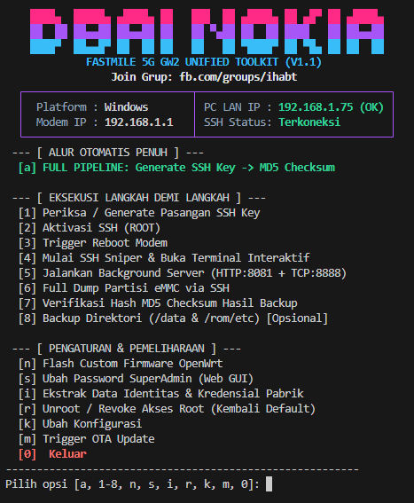

<h1 align="center">DBAI-NOKIA: Nokia FastMile 5G Gateway 2 (GW2) Unified Toolkit</h1>

<p align="center">
  
  
  
  
  
</p>

<div align="center">

<pre align="center">
████▄  █████▄ ▄████▄ ██   ███  ██ ▄████▄ ██ ▄█▀ ██ ▄████▄
██  ██ ██▄▄██ ██▄▄██ ██   ██ ▀▄██ ██  ██ ████   ██ ██▄▄██
████▀  ██▄▄█▀ ██  ██ ██   ██   ██ ▀████▀ ██ ▀█▄ ██ ██  ██
FASTMILE 5G GW2 UNIFIED TOOLKIT (V1.1)
</pre>

</div>

**DBAI-NOKIA Toolkit** adalah instrumen terpadu (*all-in-one unified toolkit*) untuk modem **Nokia FastMile 5G Gateway 2 (MediaTek MT6890 / T750)**. Toolkit ini menyediakan alur otomatisasi penuh: aktivasi layanan SSH Root terintegrasi, penguncian port SSH otomatis (SSH Sniper & Guardian Daemon), streaming backup eMMC hardware partition dump (52 partisi lengkap) via TCP socket berkecepatan tinggi, validasi MD5 checksum otomatis dengan targeted auto-retry, terminal interaktif root shell, audit kredensial identitas pabrik, pengubah password SuperAdmin Web GUI, hingga pemicu OTA update resmi.

Tersedia dalam bentuk **Single Binary Executable (Zero-Dependency)** yang telah dikompilasi ke kode mesin native C. Seluruh dependensi dan aset pendukung telah terintegrasi di dalam satu file. **Tinggal unduh satu file dan langsung jalankan—tanpa perlu menginstal Python, runtime, maupun dependensi eksternal apapun!**

---

## ⚡ Download & Jalankan Langsung (Tinggal Copas)

### 🪟 Windows (10 / 11 64-bit)
👉 **[Download `dbai-nokia-win64.exe`](https://github.com/armarchindo/nokia-gateway-2/releases/download/nokia_hifiair_tools_v1_1/dbai-nokia-win64.exe)** *(Download lalu **double-click** untuk langsung jalan)*

Atau via 1 baris perintah PowerShell:
```powershell
Invoke-WebRequest -Uri "https://github.com/armarchindo/nokia-gateway-2/releases/download/nokia_hifiair_tools_v1_1/dbai-nokia-win64.exe" -OutFile "dbai-nokia-win64.exe"; .\dbai-nokia-win64.exe
```

---

### 🐧 Linux PC (x86_64 — Ubuntu / Debian / Fedora / Arch)
```bash
curl -L -o dbai-nokia-linux-x86_64 "https://github.com/armarchindo/nokia-gateway-2/releases/download/nokia_hifiair_tools_v1_1/dbai-nokia-linux-x86_64" && chmod +x dbai-nokia-linux-x86_64 && ./dbai-nokia-linux-x86_64
```

---

### 🍓 Armbian / SBC / STB (ARM64 — Amlogic, RK3588, Raspberry Pi)
```bash
curl -L -o dbai-nokia-linux-aarch64 "https://github.com/armarchindo/nokia-gateway-2/releases/download/nokia_hifiair_tools_v1_1/dbai-nokia-linux-aarch64" && chmod +x dbai-nokia-linux-aarch64 && ./dbai-nokia-linux-aarch64
```

---

## 📋 Fitur Utama Toolkit (v1.1)

1. **🚀 Full Automated Pipeline (Menu `[a]`)**:
   - Satu langkah mengeksekusi seluruh siklus dari awal hingga tuntas:
     `Generate Key` ➔ `Aktivasi Akses Root` ➔ `Kirim Sinyal Reboot` ➔ `SSH Sniper Lock` ➔ `Background Servers` ➔ `Full 52-Partisi eMMC Dump` ➔ `Verifikasi MD5 Checksum` ➔ `Auto-Ekstraksi Kredensial & Identitas Pabrik`.
2. **🔑 Ekstraksi Identitas & Kredensial Pabrik (Menu `[i]`)**:
   - **Data Identitas Pabrik (`Factory_MIM`)**: Serial Number, MAC Address, IMEI, OperatorID, CountryID, HWVersion, ICS, CLEI, Mnemonic, ProgDate, Part Numbers.
   - **Audit Kredensial Lengkap**:
     - Password WiFi default.
     - Password Root Console UART & Root SSH (termasuk verifikasi hash `/etc/shadow`).
     - Kredensial ACS & ACSCR (TR-069 remote management).
     - Akun Web GUI `admin` (pencocokan SHA-256 dan stiker fisik).
     - Akun Web GUI `superadmin` (ekstrak hash SHA-256 via dekriptor TrustZone, lookup status crack potfile Hashcat otomatis, serta panduan brute-force Hashcat).
   - **Dukungan Dua Mode**:
     - *Opsi 1 (Live SSH)*: Mendekripsi langsung dari hardware router hidup menggunakan runtime chip MediaTek TrustZone (TEE).
     - *Opsi 2 (Dump Offline)*: Memindai file partisi `Factory_MIM.img` atau folder scatter dump secara offline di PC (transparan: menandai hash superadmin aman dan tidak memalsukan hash TrustZone).
   - Menyimpan laporan otomatis ke file `image_backup/credentials/info_<SN>.txt`.
3. **👑 Manajemen Password SuperAdmin Web GUI (Menu `[s]`)**:
   - Mengaktifkan dan mengubah password akun `superadmin` Web GUI hak penuh langsung ke database konfigurasi NAND modem (`/configs`).
   - Membuka fitur lanjutan yang disembunyikan operator: **Cell Lock (4G/5G)**, **Band Locking**, konfigurasi APN multi-profil, dan diagnostik radio.
4. **📡 Pemicu OTA Update Resmi (Menu `[m]`)**:
   - Memicu pengecekan dan instalasi update firmware FOTA resmi langsung dari server Nokia Cloud (`swupd.wifi.nokia.com`) via sinyal D-Bus (`triggerOtaPollingFromPortal` / `pollMatrixFromCloud`) tanpa menunggu siklus update berkala.
5. **⚡ High-Speed Direct Hardware Streaming**:
   - Menarik file partisi langsung dari block device eMMC (`/dev/mmcblk0*`) melalui socket streaming TCP (port 8888).
   - **Zero RAM Buffer di Modem**: Bebas resiko OOM (*Out of Memory*), aman untuk partisi berukuran gigabyte (`rootfs_a`, `rootfs_b`, `container`).
6. **🛡️ Smart SSH Sniper & Anti-Watchdog Guardian**:
   - Memantau siklus reboot modem dan langsung mengunci port SSH `2222` saat sistem pertama kali membuka jalur akses.
   - Menginjeksi daemon penjaga di RAM modem untuk memastikan port SSH tetap terbuka dan kebal terhadap watchdog internal Nokia.
7. **🔍 Validasi MD5 Otomatis dengan Targeted Auto-Retry**:
   - Menghitung hash MD5 secara independen di komputer dan mencocokkannya dengan sertifikat asli dari hardware modem (`md5sums.txt`).
   - Targeted auto-retry: hanya mengunduh ulang partisi yang bermasalah (hingga 3x) tanpa mengulang partisi yang sudah valid.
   - Pengecualian otomatis (*WAJAR-RW*) untuk partisi aktif dinamis (`user_data` dan `swr`).
8. **🧙 Startup Wizard & Persistence (`config_toolkit.json`)**:
   - Deteksi otomatis IP LAN PC adapter.
   - Menyimpan IP modem dan password web admin yang telah terverifikasi sehingga pengguna tidak perlu memasukkan kredensial berulang kali.
9. **💻 Built-in Interactive SSH Terminal (Menu `[4]`)**:
   - Terintegrasi terminal root shell langsung di dalam toolkit tanpa memerlukan PuTTY atau software eksternal.
10. **🔄 Unroot / Revoke Akses Root (Kembali Default - Menu `[r]`)**:
    - Mengembalikan modem ke setelan standar non-root bawaan pabrik dengan menghapus seluruh file hook di `/configs`. Mendukung eksekusi via SSH maupun Web API.
11. **🎭 Modul Komunitas OpenWrt (Menu `[n]`)**:
    - Fitur hiburan / Easter egg komunitas bagi rekan-rekan pengguna Nokia GW2.

---

## 🔐 Arsitektur Keamanan: Mengapa Superadmin Butuh Mode Live?

| Akun | Letak Penyimpanan | Mekanisme Enkripsi | Cara Ekstraksi |
| :--- | :--- | :--- | :--- |
| **`admin`** (Web GUI Biasa) | Partisi `Factory_MIM` | Hash SHA-256 (Base64) | Dapat dibaca **secara Live** maupun **Dump Offline**. Password plaintext tertera di stiker fisik modem. |
| **`superadmin`** (Web GUI Full Rights) | File `/configs/config_encryption.cfg` (`WebAccount.PresetPassword`) | **Hardware TrustZone (TEE)** chip MediaTek MT6890 | **Wajib Mode Live (Opsi 1 / SSH)**. Kunci enkripsi terikat pada silikon SoC modem, sehingga dump file statis di PC tidak bisa didekripsi secara offline tanpa chip fisik modem yang menyala. |

Toolkit ini memisahkan kedua mekanisme tersebut secara transparan, akurat, dan tidak merekayasa/memalsukan data.

---

## ⚠️ Checklist Wajib Sebelum Melakukan Full Dump eMMC

Sebelum mengeksekusi Menu **[a]** atau Menu **[6]** (Full Dump eMMC):

| No | Langkah Persiapan | Penjelasan |
| :---: | :--- | :--- |
| 1 | **Lepas Kartu SIM** | Cabut kartu SIM seluler agar koneksi internet terputus dan partisi sistem tidak aktif menulis log data. |
| 2 | **Pastikan Modem IDLE** | Putuskan perangkat lain dari WiFi/LAN Nokia. Hanya hubungkan kabel LAN antara modem dan PC Anda. |
| 3 | **Catat Password Admin Web** | Password admin web tertera di stiker fisik bagian bawah modem (bukan password WiFi). |
| 4 | **Pastikan Satu Segmen IP** | PC harus berada di subnet yang sama dengan modem (`192.168.1.x`). Toolkit otomatis mendeteksi dan memberi peringatan jika subnet berbeda. |
| 5 | *(Disarankan)* **Factory Reset** | Lakukan Factory Reset lebih dulu via tombol reset di modem agar partisi read-write dalam kondisi bersih. |

---

## 🖥️ Tampilan Menu Utama (v1.1)

<p align="center">
  
</p>

---

## 📂 Output Folder Saat Dijalankan

Setelah binary dijalankan, toolkit akan secara otomatis membuat file konfigurasi dan folder backup di direktori yang sama:

```text
./
├── dbai-nokia-win64.exe (atau binary Linux)    # File binary toolkit mandiri
├── config_toolkit.json                        # Konfigurasi IP & kredensial terverifikasi (auto-save)
├── fastmile_key / fastmile_key.pub            # Pasangan kunci SSH (dibuat saat opsi [1]/[a])
└── image_backup/                              # Folder hasil backup otomatis (dibuat saat opsi [6]/[a])
    ├── md5sums.txt                            # Sertifikat hash asli dari hardware modem
    ├── report.txt                             # Laporan verifikasi integritas backup
    ├── non-userarea/                          # Partisi Boot0 & Boot1
    ├── *.img                                  # 50 file image partisi eMMC lengkap
    └── credentials/                           # Laporan identitas & kredensial pabrik
        └── info_<SN>.txt                      # Dump kredensial lengkap (WiFi, UART, SSH, Web, Hashcat)
```

---

## ❓ FAQ & Troubleshooting

<details>
<summary><b>1. Muncul peringatan: BEDA SUBNET dengan Modem!</b></summary>

* **Penyebab**: IP interface PC Anda tidak satu segmen dengan IP modem (`192.168.1.1`).
* **Solusi**: Sambungkan kabel LAN PC langsung ke port LAN modem Nokia dan pastikan adapter LAN PC diset DHCP (*Obtain an IP address automatically*), atau masukkan IP manual (misal: `192.168.1.100`).
</details>

<details>
<summary><b>2. Status SSH "Belum Terkoneksi" / Connection Refused</b></summary>

* **Penyebab**: Watchdog firewall internal Nokia mematikan service sshd setelah modem boot normal beberapa menit.
* **Solusi**: 
  - Pilih **Menu [4]**. Toolkit akan mendeteksi Web Admin aktif dan otomatis menawarkan opsi:
    `[1] Kirim Sinyal Reboot Resmi ke Modem & Mulai SSH Sniper (Rekomendasi)`
  - Toolkit akan memicu reboot resmi dan langsung mengunci port SSH sesaat saat modem menyala kembali.
</details>

<details>
<summary><b>3. Mengapa partisi user_data.img dan swr.img bertanda [WAJAR-RW]?</b></summary>

* **Penjelasan**: Partisi `user_data` (data aplikasi) dan `swr` (firmware rollback counter) adalah partisi *live read-write* yang ditulis secara berkala oleh sistem operasi Nokia saat modem menyala. Perbedaan hash pada partisi ini adalah normal dan tidak memengaruhi pemulihan firmware (*safe exclusion*).
</details>

<details>
<summary><b>4. Mengapa pada Dump Offline, Password SuperAdmin tertulis [Terenkripsi Hardware TrustZone]?</b></summary>

* **Penjelasan**: Password `superadmin` tidak disimpan dalam teks polos atau hash biasa di partisi data, melainkan dienkripsi dengan chip keamanan hardware MediaTek TrustZone (TEE). Untuk membaca hash SHA-256 aslinya, hubungkan modem dan jalankan **Menu [i] -> Opsi [1] Live dari Modem via SSH**.
</details>

---

## ⚖️ Lisensi & Disclaimer

Tool ini dikembangkan untuk tujuan pemeliharaan perangkat (*hardware backup & recovery*), riset firmware, dan edukasi pribadi. Gunakan dengan penuh tanggung jawab atas perangkat milik Anda sendiri.
