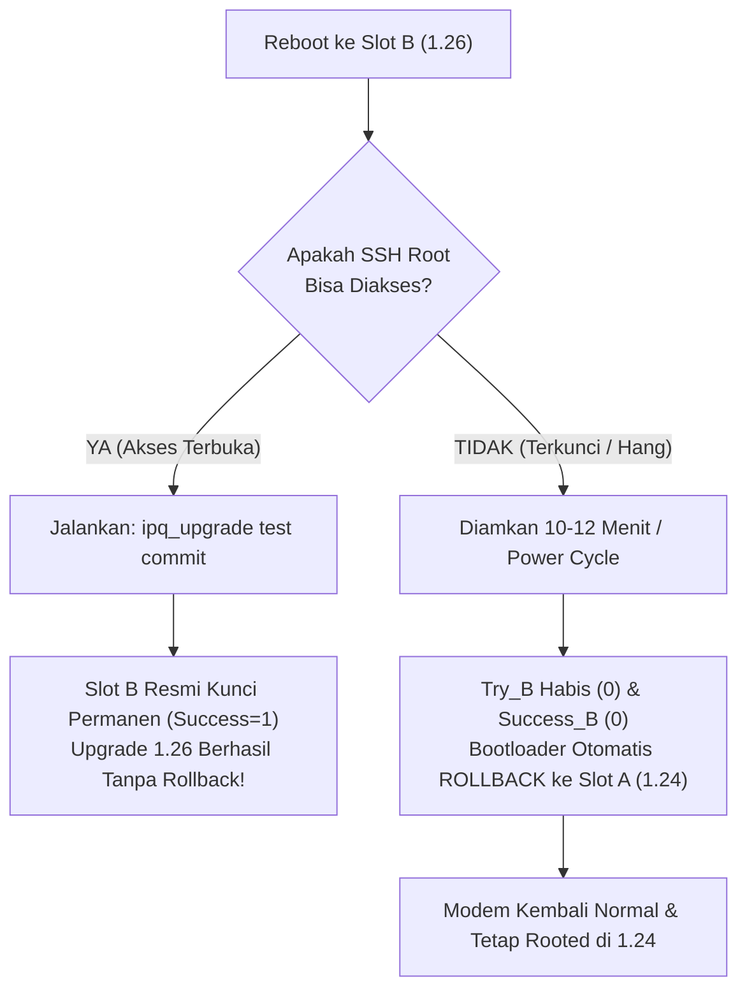

# 🛡️ Panduan Teknis: Mencegah Rollback Otomatis & Commit Firmware 1.26 di Nokia FastMile 5G Gateway 2

> **Model Target:** Nokia FastMile 5G Gateway 2 (`5GGW2-OMNI-2` / MediaTek MT6890 / eMMC)  
> **Kondisi Awal:** Modem saat ini berjalan di **Slot A (Firmware 1.24)** dengan **akses root**, sementara **Firmware 1.26** sudah ter-flash utuh di **Slot B** namun sebelumnya mengalami *rollback* otomatis ke 1.24 akibat *ACS timeout*.

---

## 1. Analisis Risiko: Mengapa Terjadi Rollback & Pilihan Metode

Pada firmware Nokia FastMile, proses perpindahan slot diatur oleh dua lapis kontrol:
1. **Lapisan Bootloader (`bootctrl` pada partisi `misc` offset `2048`):** Membaca parameter `Priority`, `Try`, dan `Success`. Jika `Try = 0` dan `Success = 0`, bootloader otomatis membalikkan boot ke slot sebelumnya yang stabil.
2. **Lapisan Daemon OS (`halswm` / `swmgnt` & `/configs/SWMState`):** Jika status update masih menunggu konfirmasi commit dari server ACS operator, modem akan menghitung mundur (~10–12 menit). Jika gagal terhubung ke ACS, daemon sengaja memicu reboot darurat (*OTA_COMMIT_FAILED*).

### Matriks Perbandingan Metode:

| Metode | Tingkat Keberhasilan | Tingkat Keamanan | Risiko Utama |
|---|:---:|:---:|---|
| **Langsung `permanent_switch`** | Sangat Tinggi | **BERBAHAYA** | Jika SSH root di 1.26 gagal jalan (karena RCE 1.24 sudah ditambal di 1.26), Anda **terkunci permanen di 1.26 tanpa root** dan kehilangan kemampuan downgrade. |
| **Metode 2-Langkah (`switch` $\rightarrow$ `commit`)** *(Direkomendasikan)* | **Tertinggi** | **PALING AMAN** | Memiliki jaring pengaman (*safety net*). Jika SSH di 1.26 tidak responsif, modem otomatis kembali ke 1.24 yang masih rooted. |

---

## 2. Tahap 1: Persiapan & Netralisasi Saat Masih di Slot A (1.24)

Jalankan perintah berikut di sesi SSH root modem saat masih berada di Slot A:

### A. Verifikasi Slot yang Sedang Aktif
Pastikan modem sedang berjalan dari Slot A:
```sh
cat /proc/cmdline | grep -o 'bootslot=[a-b]'
```
*Output yang diharapkan: `bootslot=a`.*

### B. Netralkan Pemicu Auto-Rollback di `/configs/SWMState`
Bersihkan penanda kegagalan lama agar daemon pembaruan di 1.26 tidak langsung memanggil script rollback:
```sh
sed -i 's/^SWMState=.*/SWMState=Committed/' /configs/SWMState
sed -i 's/^SWUpgradeResult=.*/SWUpgradeResult=0/' /configs/SWMState
sed -i '/^SWMFailureCause=/d' /configs/SWMState
sync
```

### C. Amankan Hook Root di Direktori Persisten (`/configs`)
Pastikan script hook persistence (seperti `/configs/aic_conf.json` dan SSH key) tetap berada di posisinya karena partisi `/configs` dibaca bersama (*shared overlay*) oleh kedua slot:
```sh
ls -la /configs/aic_conf.json /configs/nonpersistant/
```

---

## 3. Tahap 2: Beralih ke Slot B Menggunakan Mode Uji Coba (*Trial Mode*)

Gunakan perintah utilitas bawaan Nokia untuk mengatur Slot B menjadi prioritas utama dengan status **percobaan** (`Try_B = 1`, `Success_B = 0`):

```sh
ipq_upgrade test switch
```
*(Atau via daemon HAL: `halswm switch`)*

Perintah ini akan:
* Menaikkan prioritas Slot B ke `15` (`0x0f`).
* Menurunkan prioritas Slot A ke `14` (`0x0e`).
* Memberikan 1 kali jatah nyawa boot ke Slot B (`Try_B = 1`).

Setelah perintah berhasil, lakukan reboot:
```sh
reboot
```

---

## 4. Tahap 3: Penanganan Pasca-Reboot

Setelah modem menyala kembali (~2–3 menit):



### Skenario A: SUKSES (SSH Root Terhubung ke 1.26)
Segera buka koneksi SSH ke port root (misal port `2222` atau `22`):
1. Verifikasi bahwa Anda sudah di 1.26:
   ```sh
   cat /etc/SWVersion
   cat /proc/cmdline | grep -o 'bootslot=[a-b]'
   ```
2. **Kunci Permanen Status Firmware Baru (Commit):**
   ```sh
   ipq_upgrade test commit
   ```
   *(Atau: `halswm commit`)*

Perintah commit ini akan menulis nilai `Success_B = 1` ke partisi `misc`. Sejak titik ini, modem **100% permanen di firmware 1.26** dan tidak akan pernah rollback lagi ke 1.24.

---

### Skenario B: GAGAL / DARURAT (SSH Root Tidak Menjawab)
Jika port SSH tidak terbuka atau web UI mengalami masalah:
* **JANGAN** lakukan intervensi apa pun.
* Cukup tunggu hingga timer watchdog habis (~10–12 menit) atau matikan adaptor daya lalu nyalakan kembali.
* Karena statusnya belum di-*commit*, bootloader mendeteksi kegagalan boot dan **secara otomatis mengembalikan (*rollback*) sistem ke Slot A (firmware 1.24)** dengan seluruh hak akses root yang masih utuh.

---

## 5. Prosedur Darurat Manual (Hardware / Direct eMMC Level)

Jika karena suatu alasan perintah `ipq_upgrade` tidak tersedia, manipulasi status bootloader dapat dilakukan langsung ke partisi `misc` menggunakan `dd`.

Tabel offset `bootctrl` pada partisi `misc` (offset `2048` / `0x800`):
* `Priority_A` = Offset `2056` (`0x808`)
* `Priority_B` = Offset `2060` (`0x80c`)
* `Success_A`  = Offset `2058` (`0x80a`)
* `Success_B`  = Offset `2062` (`0x80e`)

Untuk mengunci paksa Slot B secara manual dari shell root:
```sh
# Dapatkan device node partisi misc
MISC_DEV=$(blkid -L misc || ls /dev/mmcblk0p*misc* 2>/dev/null || echo "/dev/disk/by-partlabel/misc")

# Set Priority_B = 15 (0x0f), Priority_A = 14 (0x0e)
printf '\x0e' | dd of=$MISC_DEV bs=1 seek=2056 count=1 conv=notrunc
printf '\x0f' | dd of=$MISC_DEV bs=1 seek=2060 count=1 conv=notrunc

# Set Success_B = 1 (0x01)
printf '\x01' | dd of=$MISC_DEV bs=1 seek=2062 count=1 conv=notrunc
sync
```

